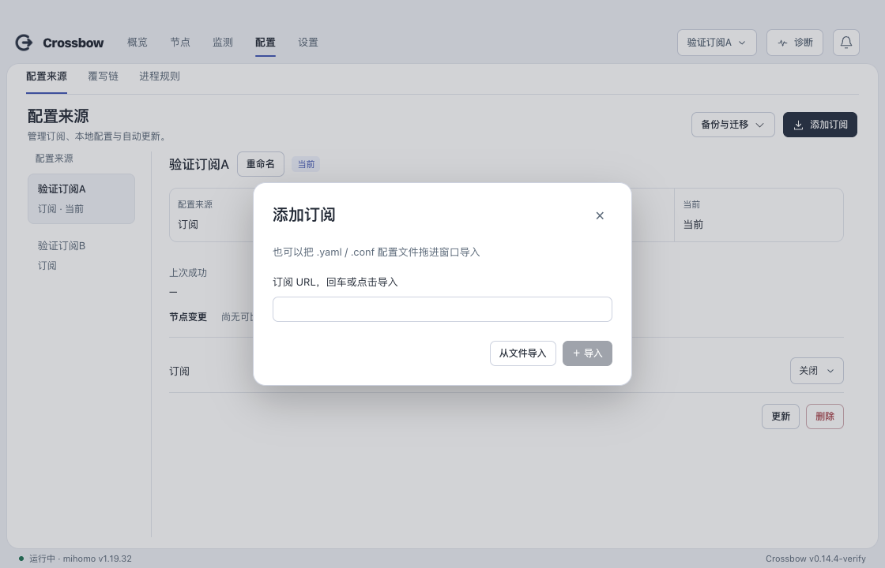
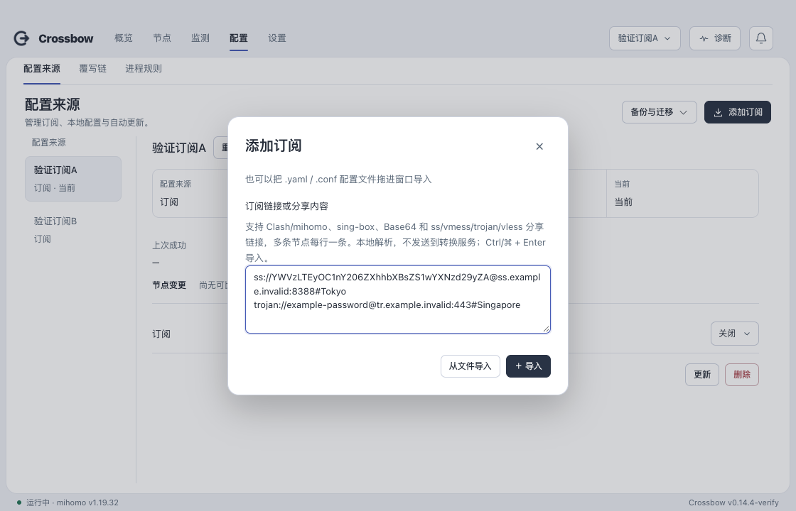

# #569 本地订阅转换与多行导入验证

2026-11-20，macOS arm64，基线 `d6a3f89`。生产 React 页面 + `scripts/dev/verify-lib.mjs` 的脱敏 IPC 桩；没有读取真实订阅、切换系统代理或操作 TUN。截图页脚版本来自统一夹具，不代表已安装原生构建版本。

## 实现选择

- 候选 A：仅补格式错误提示。回归面小，但用户仍不能导入 Base64/URI。
- **最佳方案 B：在 core 建立共用本地归一化入口**，URL 拉取（含刷新）、文件、粘贴均复用。完整配置保留原文；节点列表转换为 mihomo YAML，复用既有渲染、存储及更新事务。无需额外服务或泄露订阅地址。
- 外置转换服务未实现。V2Ray/Xray 原生客户端 JSON、REALITY、SS 插件、VLESS flow 等尚不支持；发现时明确拒绝，不丢弃参数后伪装成功。详见 [支持范围](../../SUBSCRIPTIONS.md)。

## 浏览器证据

| 基线：单行输入 | 修改后：多行分享内容 |
| --- | --- |
|  |  |

- 基线截图：在本工作区暂时使用 `origin/main` 的原始 `Profiles/index.tsx`，同一生产页面和 IPC 夹具，1120×720、浅色中文。截图后立即恢复本次组件。
- 改后：1120×720、浅色中文；Enter 不提交，Ctrl+Enter 恰好提交一次完整多行内容；模拟失败后输入保留、弹窗保留、导入按钮恢复可重试。
- [880×560 深色中文](import-dark-small.png)、[880×560 深色英文](import-dark-small-en.png)：弹窗不超出视口，页面无横向溢出。
- [统计页共享按钮](stats-shared-button.png)：#584 最小修复保留日期柱外观、鼠标与 Enter 选择和 `aria-pressed`。该独立问题是 main 已有原生按钮绕过 `ButtonBase`，触发前端门禁；未放宽测试。
- 复跑：仓库根目录执行 `node docs/reviews/issue-569/verify.mjs`。用 `CB569_ARTIFACT_DIR=/tmp/cb569-review` 可将新截图写入其他目录；`--before` 仅适用于基线组件。

## 本地检查

- core：103 通过、1 忽略（真实内核用例单独启用）；覆盖四协议、Base64 多变体、IPv6/转义、重复名、TLS/WS/gRPC、拒绝未知/冲突参数、格式/行号诊断与脱敏、HTTP 订阅及流量头、模型导入/切换/更新/序列化恢复/删除。
- 新增回归先复现：VMess/VLESS 明确关闭 TLS、端口 443，原 sing-box 转换器仍强制开启 TLS；修正为端口只提供缺省值，显式开关优先，协议必须 TLS 的 Trojan/Hysteria2 保持启用。
- 桌面后端：304 通过、2 忽略。`TAURI_CONFIG='{"bundle":{"externalBin":[]}}'` 用于本地测试编译，不改变产品打包配置。
- workspace Clippy（`--all-targets -- -D warnings`）、rustfmt、前端 TypeScript/Vite 构建、43 项前端测试通过。
- 真实 mihomo：单独启用 `real_mihomo_validates` 通过，检查 SS/VMess/Trojan/VLESS、WS/gRPC 的生成配置；只在临时目录执行 `-t`，不启动代理或连接测试节点。

## 待验与边界

模拟浏览器不证明原生 IPC/权限正常，配置语法校验不证明真实节点测速或出流量。真实订阅服务器、远程更新失败时的原生内核回滚、双平台完整导入/切换/删除仍待验。PR/CI/发布状态以 GitHub 为准，本目录截图不代表发布验收。
