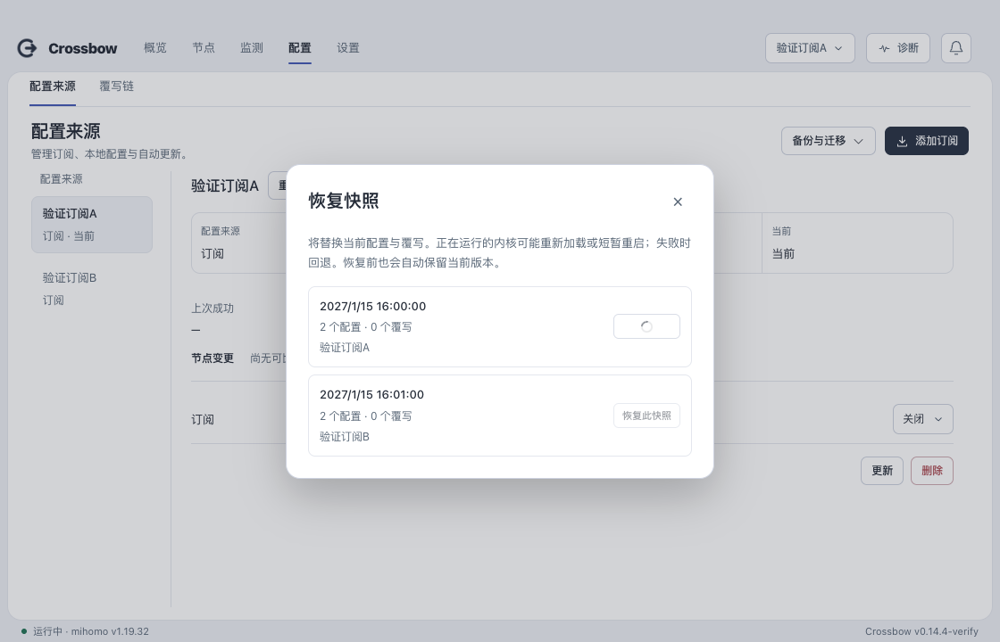

# PR #574 验证证据

2026-11-20，macOS arm64，系统 Chromium 157.0.8103.79，1120×720，浅色中文。
生产 React 组件 + `scripts/dev/verify-lib.mjs` 的脱敏 IPC 桩；没有操作真实订阅或系统代理。

- 改前：在 PR 原头 `b62407ca` 的独立工作区中，仅将 `ConfigRecovery/index.tsx` 换成 merge-base `07a8292d` 的原组件。首次恢复返回成功后，等待 8 秒仍无法释放按钮，场景 5 按预期失败。
- 改后：PR 的生产恢复组件连续完成两次成功恢复，两个按钮均恢复可用；另一个回归场景验证两次成功、一次失败、失败后成功重试。PR 的恢复组件在评审中未再修改。
- 截图只证明前端按钮状态；真实快照落盘、内核重载及系统代理恢复仍需原生验收。

| 改前：恢复后持续忙碌 | 改后：连续恢复后可继续操作 |
| --- | --- |
|  |  |

可重复运行：`pnpm verify:desktop --scenario 5`。

共享流另由场景 6 验证前端订阅身份及迟到清理；Rust 单测覆盖按身份释放、并发交接及迟到补订，单独启用的真实 mihomo 流量 WebSocket 用例验证传输。IPC 桩不能代替真实后端/原生页面切换验收。
