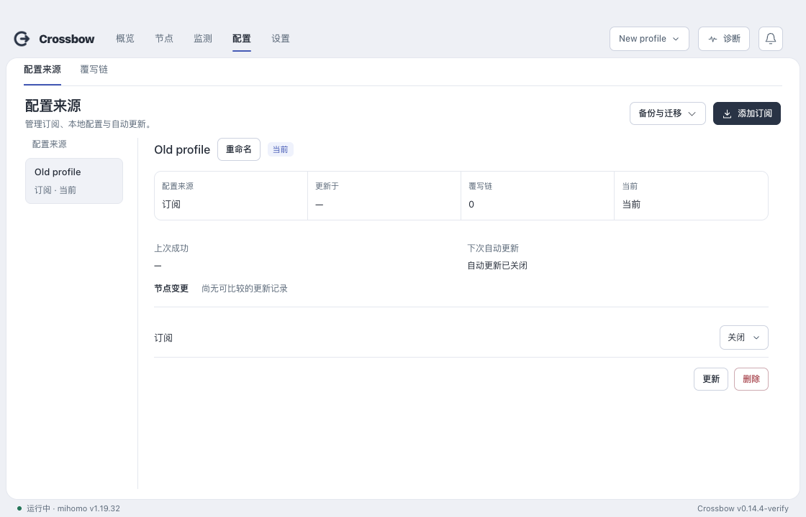

# PR #578 评审证据

关联 #565。2026-11-20，macOS arm64、Chromium 157.0.8103.79、1120×720、
浅色中文；实际生产 React 组件与脱敏 IPC 桩，不操作真实配置、代理或内核。

- 改前：PR merge-base `07a8292`，先挂起旧配置读取，再由更新事件读到 New profile，
  最后放行旧响应。旧响应把列表和详情改回 Old profile，顶部与详情不一致。
- 改后：PR `7e113d9` 合入 main `1df75dd` 后的评审修复工作树，同样的响应顺序；
  旧响应被读取序号守卫丢弃，保留 New profile。
- 新增 `pnpm verify:desktop --scenario 10`，覆盖暂停/恢复不重建通道、暂停期关闭
  成功/失败、恢复应用最新帧、旧读取不能覆盖新读取、导入未完成时切页、迟到订阅释放。
- 全部 10 个模拟场景和 43 个前端 Node 测试通过，TypeScript/Vite 生产构建通过。
  不把浏览器模拟当作真实内核断连与 WebView2 验收。

