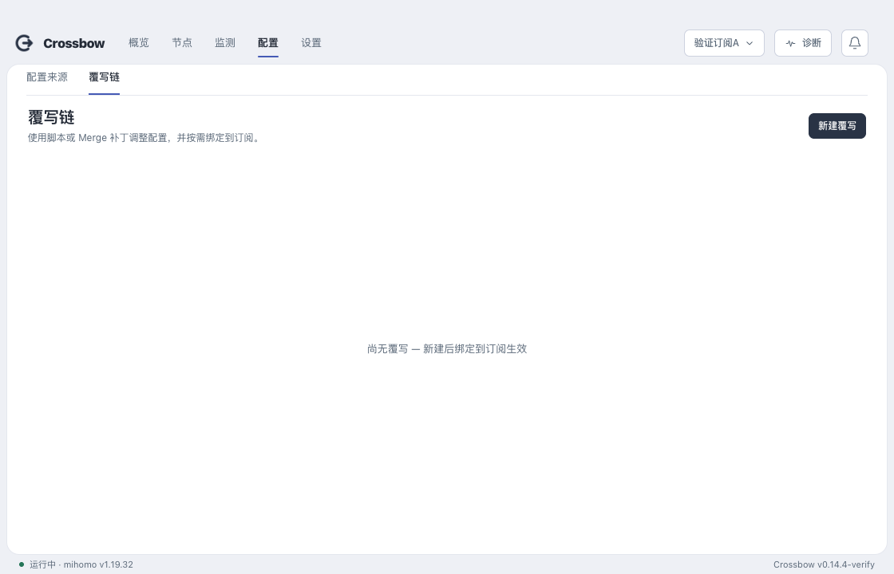
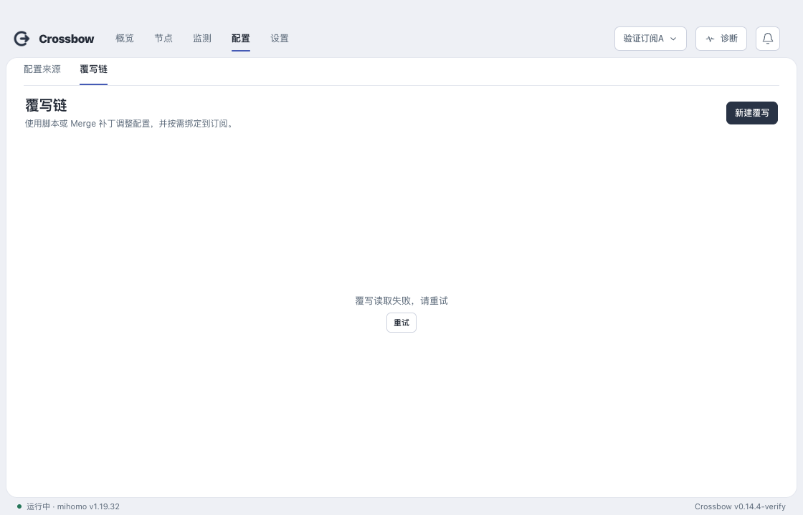
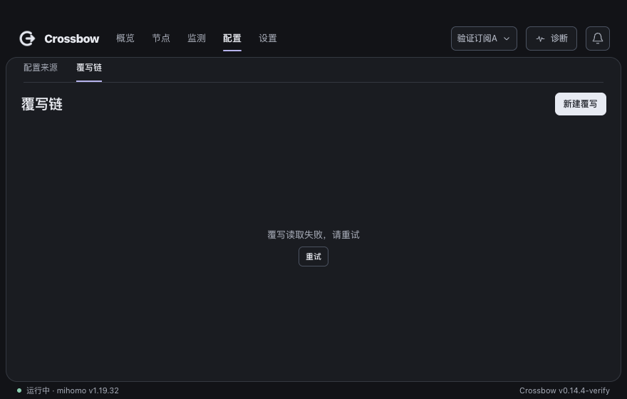

# PR #579 评审：覆写读取失败与重试

关联 #562、#563。证据采集于 2026-11-20，直接渲染生产 React 页面，通过
`scripts/dev/verify-lib.mjs` 注入脱敏 IPC 失败，不操作真实配置、代理或内核。

- 改前：PR merge-base `07a8292`，1120×720、浅色、中文；`list_overrides`
  拒绝后显示“尚无覆写”，无法区分真实空列表与读取失败。
- 改后：修复提交 `2c62608` 合入 main `4224f33` 的冲突解决工作树；Chromium
  157.0.8103.79、macOS arm64。浅色 1120×720、深色 880×560、中文；失败显示
  读取错误和重试入口。对应 `pnpm verify:desktop --scenario 7`。
- 模拟回归验证重试成功解除 `override-load` 通知；诊断修复失败仍复检、后端操作
  不重复发布前端通知；结构化启动错误保持可读详情；可选读取失败不污染整页状态。
- 本地检查：合并后桌面 Rust 库 285 通过、2 忽略，Clippy 无警告；前端 Node
  测试 43 通过，生产组件模拟场景 9 通过。截图不代表原生平台端口/权限验收。

## 改前：读取失败被伪装为空态

## 改后：错误态与重试

